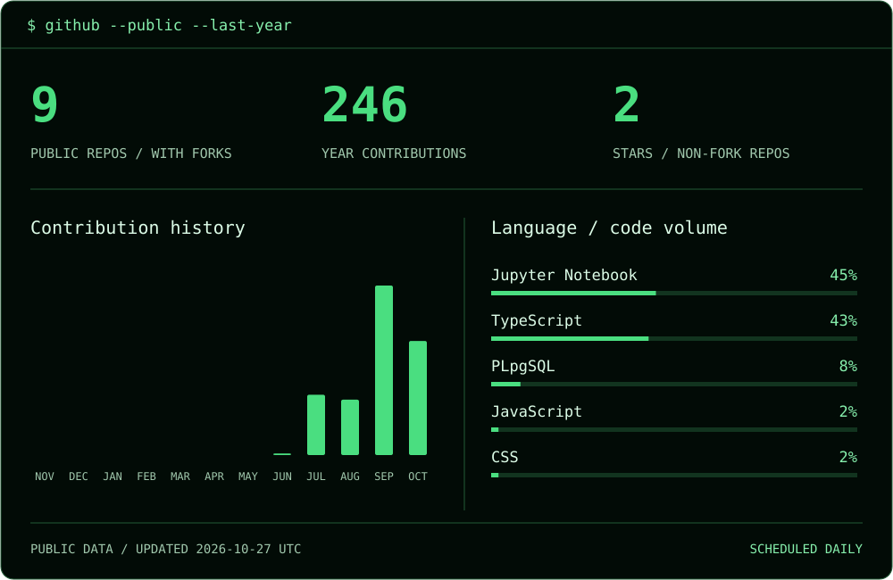

<picture>
  <source media="(max-width: 640px)" srcset="assets/green-screen-mobile.svg">
  
</picture>

<p align="center">
  <strong>Applied machine learning. Developer tools. Clear explanations.</strong><br>
  <a href="https://github.com/thotashashank302?tab=repositories">Repositories</a> ·
  <a href="https://github.com/search?q=author%3Athotashashank302+is%3Apr&type=pullrequests">Open-source contributions</a>
</p>

## `$ whoami`

I'm **Shashank Thota**, an AI/ML developer building practical machine-learning projects and tools that make code easier to understand. I work across the model, interface, and explanation, and learn by building, testing, and contributing to open source.

```text
shashank@github:~$ cat principles.txt
> Build useful things.
> Keep the human in control.
> Explain how they work.
```

## `$ ls -la ~/projects`

### [01 / Comic Code](https://github.com/thotashashank302/Code-Comic)

Turns selected source files from a GitHub pull request into a grounded four-panel visual explanation. Connects a Chrome side panel, a Next.js app, read-only GitHub access, private storage, and background jobs.

`TypeScript` · `Next.js` · `Chrome Extension` · `GitHub Apps` · `Supabase` · `Trigger.dev`

### [02 / Credit Card Delinquency Prediction](https://github.com/thotashashank302/Delinquency-Prediction-Model-With-AI-AGENT)

A tabular ML demo with reproducible training, risk bands, evaluation, and batch scoring. Its outreach workflow uses **rule-based, operator-approved email reminders**.

`Python` · `Pandas` · `scikit-learn` · `Random Forest`

<details>
<summary><strong>03 / New Life — concept notebook</strong></summary>

An exploratory concept for maternal-health awareness: reminders, possible risk indicators, and escalation to a doctor. Concept only; not a deployed medical product.

</details>

## `$ ls ~/skills`

| Area | Working with |
| :--- | :--- |
| Languages | Python · TypeScript |
| Machine learning | Pandas · scikit-learn · model evaluation |
| Product development | Next.js · React · Chrome Extensions |
| Tools & infrastructure | Git · GitHub Apps · Supabase · Vercel |
| Practice | LeetCode · CodeChef · Codeforces |

## `$ github --public --last-year`



<sub>Public data, refreshed daily. Language shares measure code volume in non-fork repositories, not proficiency.</sub>

## `$ snake --eat=contributions`

<picture>
  <source media="(prefers-color-scheme: dark)" srcset="assets/snake-dark.svg">
  <source media="(prefers-color-scheme: light)" srcset="assets/snake-light.svg">
  
</picture>

## `$ ssh connect`

[Find me on GitHub →](https://github.com/thotashashank302)
